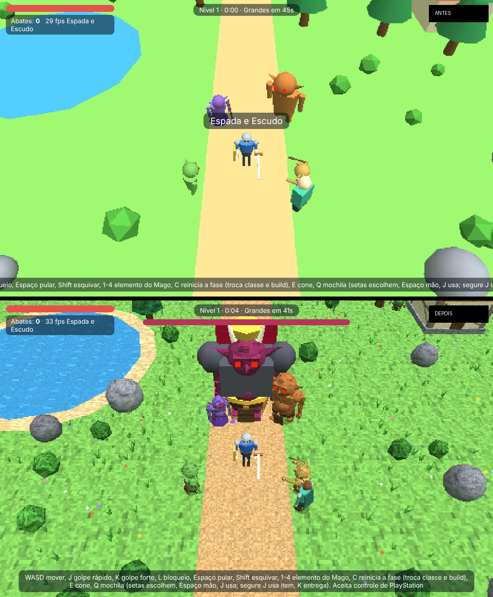

# Arena de Honra

Action RPG de horda em 3D low-poly (estilo PS1) que roda direto no navegador,
no PC e no celular. Escolha raça, classe e build, sobreviva às ondas de
inimigos, derrote o boss de cada nível e jogue com amigos pelo multiplayer
online P2P.

> Projeto preparado para ser aberto e evoluído no
> [OhMyGame](https://github.com/WhiteTowerAI/ohmygame). A versão de testes fica em `Arena-de-honra-`.

## Como jogar

Abra o `index.html` no navegador. Para instalar como app no celular, ou para
o multiplayer funcionar direito, sirva a pasta por HTTP, por exemplo:

```sh
npx serve .
# ou
python3 -m http.server 8000
```

| Ação | Teclado | Controle (PlayStation) |
| --- | --- | --- |
| Mover | WASD / setas | Analógico esquerdo |
| Golpe rápido / forte | J / K | ○ / △ |
| Bloqueio (parry no tempo certo) | L | □ |
| Pular | Espaço | ✕ |
| Esquivar | Shift | R1 |
| Mochila | Q | L1 |
| Extra / cone | E | R2 |
| Elemento do Mago | 1–4 | Direcional |
| Reiniciar a fase (troca classe e build) | C | Share |
| **Pausar** | **Esc / P** | — |

No celular aparecem joystick e botões na tela. As teclas podem ser trocadas
em **Configurações**.

## Novidades

- **Nome e ícone:** o jogo se chama Arena de Honra em toda parte e tem ícone próprio.
- **Instalável:** dá para adicionar à tela inicial do celular (PWA), em tela cheia e na horizontal.
- **Pausa:** Esc ou P pausam o single player. O jogo também pausa sozinho quando você troca de aba. O multiplayer não pausa.
- **Números de dano:** cada golpe e cada magia mostra quanto tirou do inimigo, e golpes fortes aparecem em amarelo.
- **Recorde:** o jogo guarda seu melhor número de abates e o nível mais alto, e mostra os dois na tela de derrota e no menu.
- **Ajuda:** a barra de controles agora quebra linha em vez de sair da tela, e some depois de 15 s de partida. Ela continua aparecendo na tela de pausa.
- **Gráficos estilo PS1:** os vértices "tremem" presos à grade de pixels e as cores usam dithering de 15 bits, tudo feito no próprio shader, sem custo extra. As texturas pixeladas (grama, terra, água animada, madeira, telhas, tijolo, pedra, tecido, pele) são geradas na hora, sem baixar nenhuma imagem.
- **Modelos mais detalhados:** os inimigos ganharam mandíbula, presas, sobrancelha, nariz, cotovelos, mãos com garras, pés, cinto, tanga e espinhos nas costas. Como cada parte vira uma malha só, eles ficaram mais leves que antes. O aliado também tem modelo novo, com capa, e as casas ganharam alicerce e lintel.
- **Cenário:** tem grama e flores divididas em blocos (só é desenhado o que aparece na tela), margem de areia no lago, sombra redonda embaixo dos personagens e variação de cor entre árvores e pedras.
- **Animações de ataque:** cada golpe agora tem antecipação (a arma recua), um movimento rápido com aceleração e um follow-through que volta suave. O corpo gira e se inclina junto, e as pernas firmam a postura. No golpe forte o personagem levanta a arma acima da cabeça e agacha ao bater. O estocada recua antes de avançar. Os braços balançam ao andar, o personagem respira parado e encolhe as pernas no pulo.
- **Efeitos:** rastro brilhante da arma com a cor de cada uma, faíscas e pedaços ao acertar, explosão de pedaços ao matar (maior no boss), estouro dourado no parry, poeira ao esquivar e ao pousar, e o inimigo "amassa" ao apanhar. As partículas são todas desenhadas de uma vez (1 chamada de desenho).
- **Jogador e animal:** o jogador ganhou boca, gola, fivela, túnica, braçadeiras, joelheiras e cano das botas. O animal tem corpo novo, com focinho, olhos, presas, cauda, pelo texturizado (o tigre tem listras) e patas que andam de verdade.
- **Configurações:** dá para ligar e desligar o "Visual PS1" e a "Grama e flores" (para celulares fracos).
- **Projeto OhMyGame:** o repositório tem `ohmygame.json`, um documento de design (`docs/design.md`) e regras para o agente (`AGENTS.md`).

## Abrindo no OhMyGame

1. Instale o OhMyGame (macOS ou Windows) pelo site oficial.
2. Clone este repositório e use **Abrir pasta**. O `ohmygame.json` faz o
   app reconhecer o projeto como *General Game*.
3. Em **Project settings → Web preview**, escolha o modo *Static files*: o
   jogo é um único `index.html` e não precisa de instalação.
4. Peça mudanças no chat. O agente lê o `AGENTS.md` e o `docs/design.md`
   antes de mexer no código, e pode jogar o jogo para conferir o resultado.



## Estrutura

```
index.html             o jogo inteiro (HTML + CSS + JS, three.js r128 e PeerJS via CDN)
manifest.webmanifest   dados do app instalável
icon.svg               ícone
ohmygame.json          tipo do projeto para o OhMyGame
docs/design.md         documento de design do jogo
AGENTS.md              regras para agentes de código (OhMyGame, Claude Code, Codex…)
```
